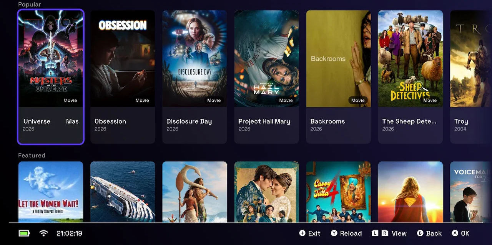
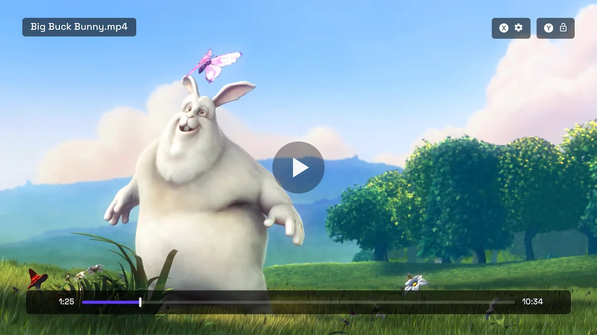
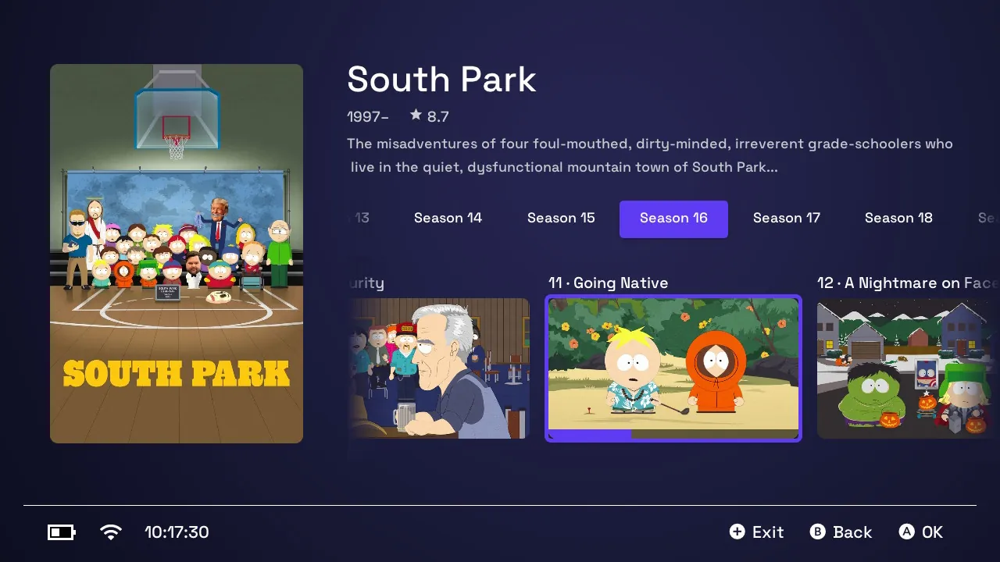

# Stremio Switch

**Stremio on the Nintendo Switch.**

Sign in to a Stremio account and browse your library, addons and sources on the
console. Torrent sources are streamed by the built-in engine as they download —
playback starts on the first pieces instead of waiting for the whole file.

> Requires a Switch running custom firmware (Atmosphère).

---

## Features

- **Stremio** — sign in, browse your library, Continue Watching, movies, shows
  and search, with artwork from the account's own addons.
- **Addon sources** — drill down from a title to a season, an episode, an addon
  and a source. BitTorrent sources stream through the on-device engine; direct
  HTTP(S) links (debrid addons) play through mpv.
- **Player** — audio/subtitle track menu, addon subtitles, analog scrubbing
  (either stick), touch controls, a control lock (Y), and auto-resume where you
  left off. Positions are reported back to the Stremio account, so Continue
  Watching stays in step across devices.
- **borealis** UI: Horizon look, controller-first, touch works too.

## Screenshots

<table>
  <tr>
    <td></td>
    <td></td>
    <td></td>
  </tr>
</table>

## Install

1. Download `stremio-switch.nro` from the [releases](../../releases), or build
   it (below).
2. Put it on your SD card in `/switch/stremio-switch/` (create the folder).
3. Launch it from the **Homebrew Menu**.

Updating is done from inside the app (Options → Check on startup is on by
default); it replaces its own .nro and restarts.

## Usage

In the app, sign in with your Stremio email and password. The session is kept
and survives a restart (sign out from Options).

Pick a title → for a show, a season, then an episode → an addon → a source.
Sources are whatever your addons return. 4K sources are hidden by default — the
Switch outputs 1080p docked, so they cost bandwidth for pixels it cannot show.
Turn that off in Options.

## Building

devkitPro is not needed locally — build in the official Docker image, keeping
the build tree in a named volume so it survives between runs:

```sh
# configure once, on a fresh volume
docker run --rm -v st_build:/build -v "$PWD":/project -w /build \
    devkitpro/devkita64:latest sh -c "cmake /project"

# build
docker run --rm -v st_build:/build -v "$PWD":/project -w /build \
    devkitpro/devkita64:latest \
    sh -c "cmake --build . --target stremio-switch.nro"

# copy the .nro out of the volume
docker run --rm -v st_build:/build -v "$PWD":/project \
    devkitpro/devkita64:latest sh -c "cp /build/stremio-switch.nro /project/"
```

On Windows/Git Bash, prefix each command with `MSYS_NO_PATHCONV=1`, or the
container paths get rewritten. Adding or removing a source file needs a `cmake .`
pass first, since the sources are globbed.

Dependencies come from devkitPro's portlibs (`switch-mpv`, `switch-curl`,
`switch-libwebp`, `switch-mbedtls`…) and are already in the image. borealis is
vendored under `library/`.

## Credits

- [Stremio](https://www.stremio.com/) — account, library and addon protocol.
  This project is not affiliated with Stremio.
- [NX Torrent Player](https://github.com/shodowlo/NX-torrent-player) by
  shodowlo — the project this is a Stremio-only fork of.
- [borealis](https://github.com/xfangfang/borealis) — UI framework (vendored,
  with one local patch: see `library/borealis/VENDORED.md`)
- [mpv](https://mpv.io/) — playback
- [libutp](https://github.com/bittorrent/libutp) — uTP transport
- [curl](https://curl.se/docs/caextract.html) — the CA bundle in
  `assets/cacert.pem`, Mozilla's root store, which is what certificates get
  checked against on a console that mounts none
- devkitPro / libnx — toolchain

## License

Apache-2.0 — see [LICENSE](LICENSE).
